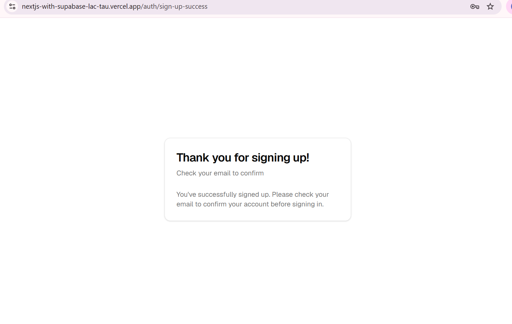
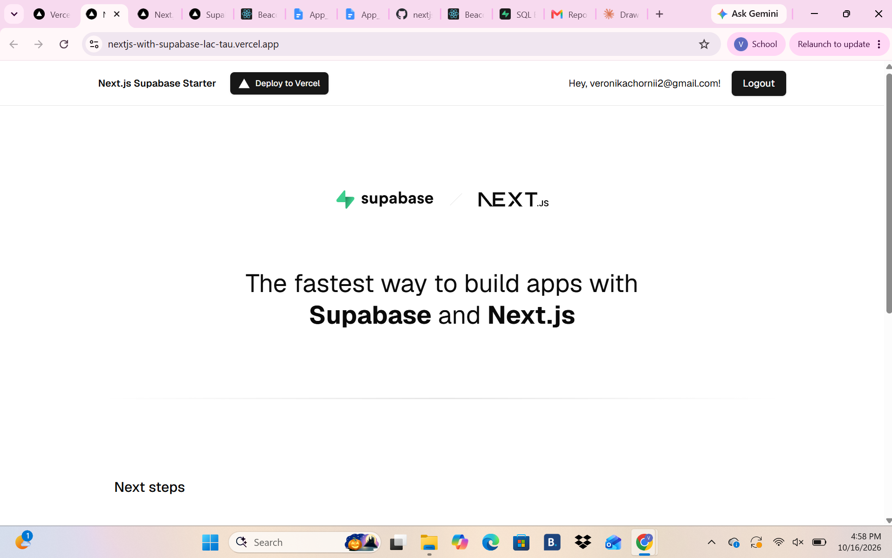
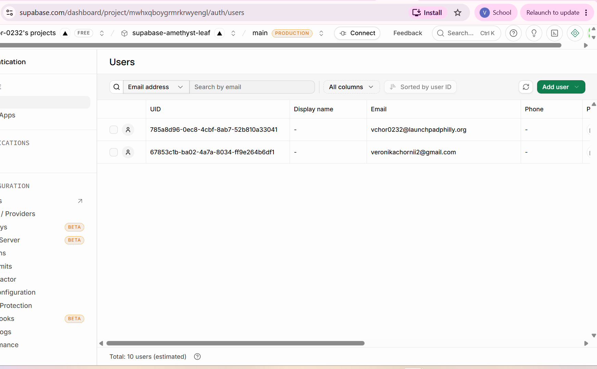
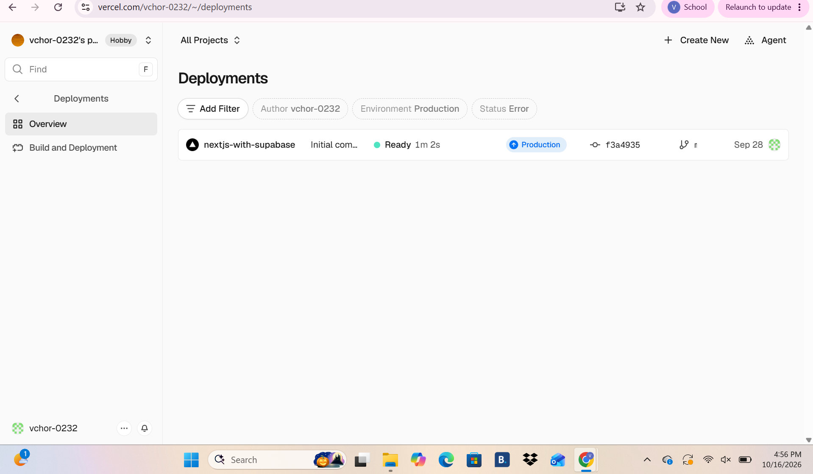
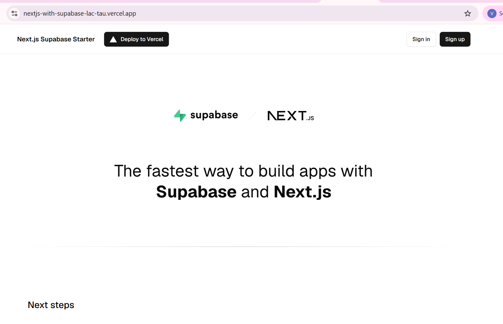
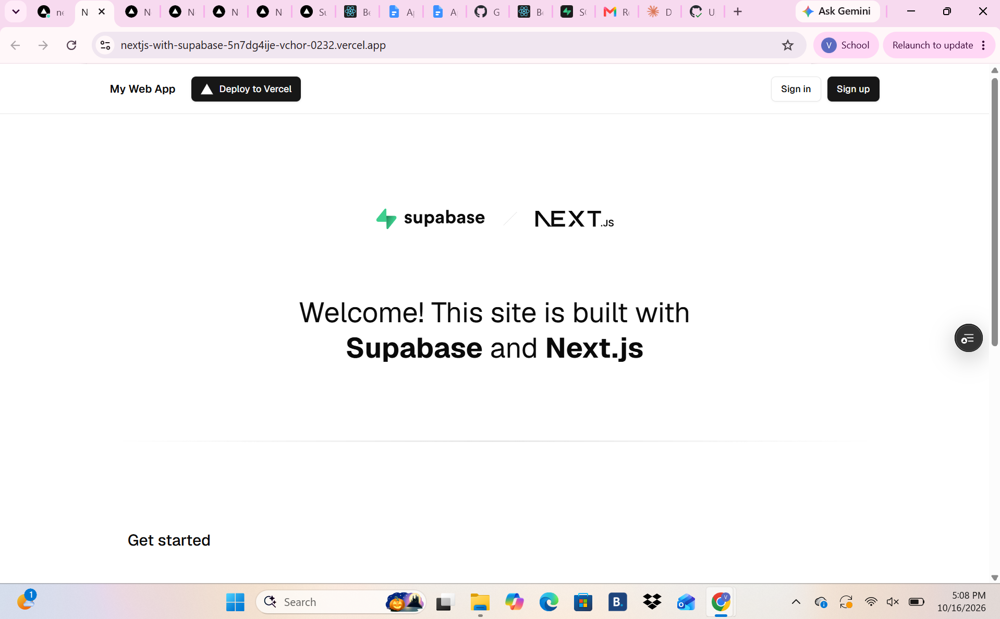

# My Web App

A web app built with Next.js and Supabase, deployed on Vercel.

**Live site:** [ADD YOUR VERCEL WEB ADDRESS HERE](https://ADD-YOUR-VERCEL-WEB-ADDRESS-HERE)

## Where does your code live?

The code lives in this GitHub repository, [Vchor-0232/nextjs-with-supabase](https://github.com/Vchor-0232/nextjs-with-supabase). It's a Next.js app written in TypeScript and styled with Tailwind CSS. The pages are in the `app` folder, the reusable pieces (like the sign-up and login forms) are in `components`, and the code that connects to Supabase is in `lib/supabase`. GitHub is the single source of truth: Claude Code works on a copy of this repo, and Vercel builds the live site from it.

## Where does your data live, and what is stored there right now?

The data lives in a Supabase project, which gives the app a Postgres database and a ready-made login system. Right now the only data stored is user accounts. When someone signs up on the site, Supabase saves their email, an encrypted version of their password, and when they signed up and last logged in, under Authentication > Users. The app doesn't have any tables of its own yet, so there's no other data stored.

## How does a change get from Claude Code to the live site?

1. I tell Claude Code what I want changed, for example "make the main color blue."
2. Claude Code copies (clones) this repo from GitHub and edits the files on a new branch.
3. Claude Code saves the change as a commit and pushes the branch up to GitHub.
4. Claude Code opens a pull request, so I can see exactly what changed before it goes anywhere.
5. I review the pull request and merge it into the `main` branch.
6. Vercel sees the new commit on `main`, builds the app, and deploys it.
7. When Vercel shows the deployment as Ready, the change is live on the site.

## What will you need to add to turn this into your team's app?

Our app helps Roblox game developers get their games seen. The starter already handles signing up, logging in, logging out, and resetting a password, so accounts are done. Every feature below needs at least one new table in Supabase, with row level security turned on so users can only change their own data, plus new pages in Next.js. All of them depend on a `games` table that stores each game's title, description, thumbnail, Roblox link, and the developer who posted it, and a form where developers submit their games. Thumbnails will be uploaded to Supabase Storage.

1. **Game spotlight (top priority).** Both game developers we interviewed said getting views is their main worry about uploading to Roblox, so the spotlight guarantees their games get seen. We'll add a `spotlights` table that records which game is featured and for which dates, and a large spotlight section at the top of the home page that shows the current featured game with a button to play it on Roblox.

2. **Interest tab (mid priority).** Users need an easy way to find games they'll actually like. We'll add genre tags to each game (with `tags` and `game_tags` tables), let users pick their interests (stored in a `user_interests` table), and build an Interests page that only shows games matching the tags they picked.

3. **Game commenting and rating (lower priority).** One interviewee said a thumbnail and description don't do a game justice, and Roblox's own rating system doesn't help small games stand out. We'll add a `ratings` table (1 to 5 stars, one rating per user per game) and a `comments` table, show the average rating on every game card, and add a comment section to each game's page.

We'll also replace the leftover starter content, like the tutorial steps on the home page and the user details on the protected page, with our own screens.

## Screenshots

### Sign-up page on the live site

### After logging in on the live site

### New user in Supabase (Authentication > Users)

### Vercel deployment is Ready

### Live site before the Claude Code change

### Live site after the Claude Code change

